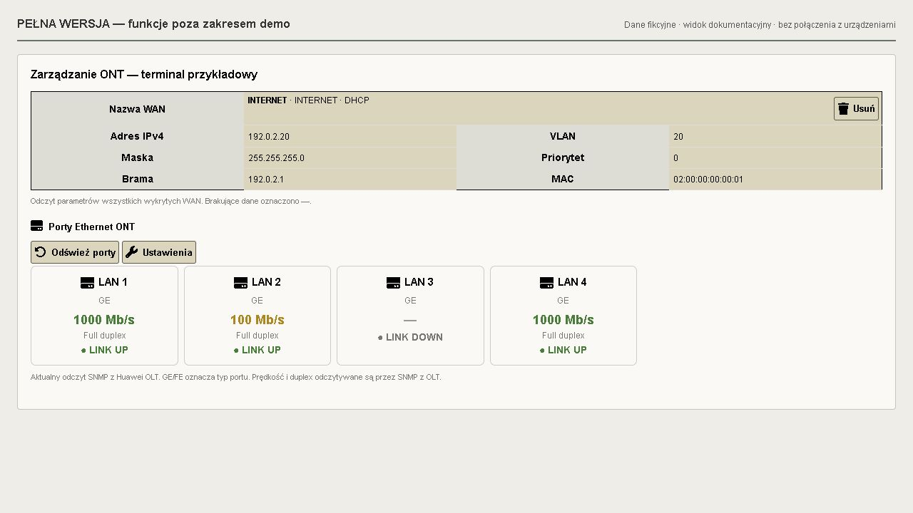

# Wtyczki LMS

Repozytorium kodu trzech wtyczek pobranego z instalacji LMS 23 października 2026 r.

| Katalog | Wtyczka | Wersja |
| --- | --- | --- |
| `plugins/NET24KsefErstePlugin` | Eksport przelewów KSeF do Erste | Brak deklaracji wersji |
| `plugins/LMSNotifyPanelPlugin` | Płatności i blokady | 0.7.4 |
| `plugins/LMSGponHuaweiDemoPlugin` | Huawei GPON — DEMO RO | 1.1.0-demo-ro-lite |

## Instalacja

Każdy katalog w `plugins/` stanowi oddzielną wtyczkę. Umieść wybrany katalog w katalogu `plugins/` swojej instalacji LMS, zachowując jego nazwę. Następnie skonfiguruj i włącz wtyczkę w LMS zgodnie z jej dokumentacją. Wtyczki mogą wymagać migracji bazy, dodatkowej konfiguracji i zadań cyklicznych; samo skopiowanie plików nie oznacza zakończenia instalacji.

- [Płatności i blokady — instrukcja](plugins/LMSNotifyPanelPlugin/README.md)
- [Huawei GPON DEMO RO — instrukcja](plugins/LMSGponHuaweiDemoPlugin/README.md)
- [Huawei GPON DEMO RO — opis wariantu](plugins/LMSGponHuaweiDemoPlugin/DEMO-VERIFICATION.md)

Eksport Erste korzysta z faktur zakupowych KSeF; rachunki nadawcy są konfigurowane w `lms.ini`. Kod znajduje się w `plugins/NET24KsefErstePlugin/`.

Repozytorium zawiera kod i pliki przykładowe. Konfiguracja instalacji LMS, hasła, klucze, dane klientów, eksporty przelewów i kopie bazy nie są częścią repozytorium.

## Zrzuty ekranu

Widoki przygotowano z szablonów wtyczek z fikcyjnymi danymi. Nie przedstawiają rzeczywistych klientów ani urządzeń. Wygląd zależy od motywu i wersji LMS.

### Płatności i blokady

### Eksport przelewów Erste

### Huawei GPON DEMO RO

### Pełna wersja Huawei GPON — poza zakresem demo

Pełna wersja udostępnia dodatkowo Auto Find i rejestrację ONT, konfigurację usług i WAN oraz zarządzanie portami LAN i Wi-Fi. Poniższy widok przedstawia pełną wersję; jej kod nie jest częścią tego repozytorium. Szczegóły i pozostałe widoki: [README Huawei](plugins/LMSGponHuaweiDemoPlugin/README.md#pelna-wersja-huawei-gpon).

## Wsparcie rozwoju

Jeśli wtyczki są dla Ciebie przydatne, możesz dobrowolnie wesprzeć ich dalszy rozwój:

[☕ Postaw kawę — wesprzyj rozwój wtyczek LMS](https://buycoffee.to/kostek_mostek)

Wsparcie jest dobrowolne i nie stanowi opłaty za instalację ani gwarancji pomocy technicznej.
