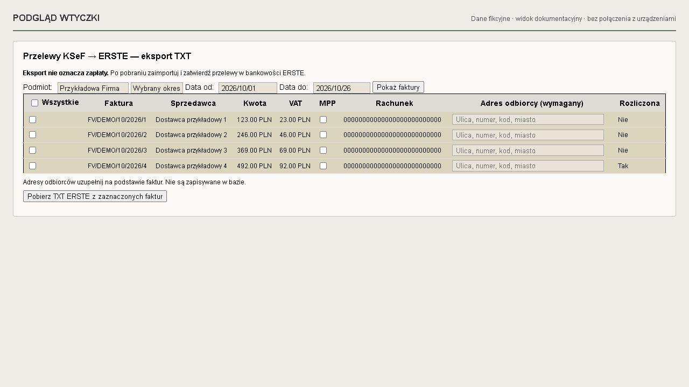
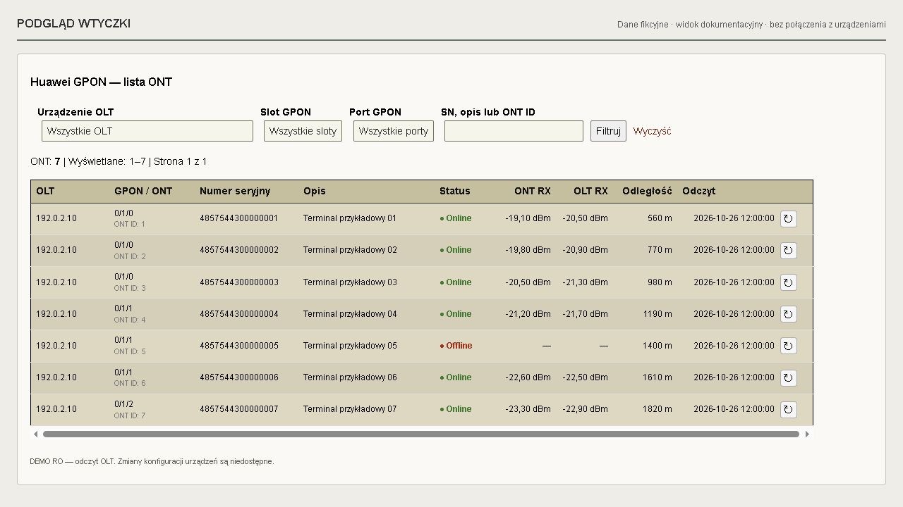
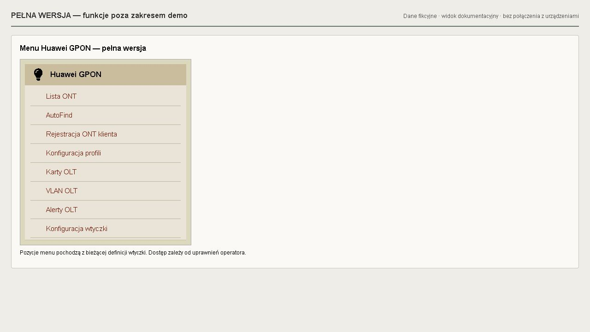
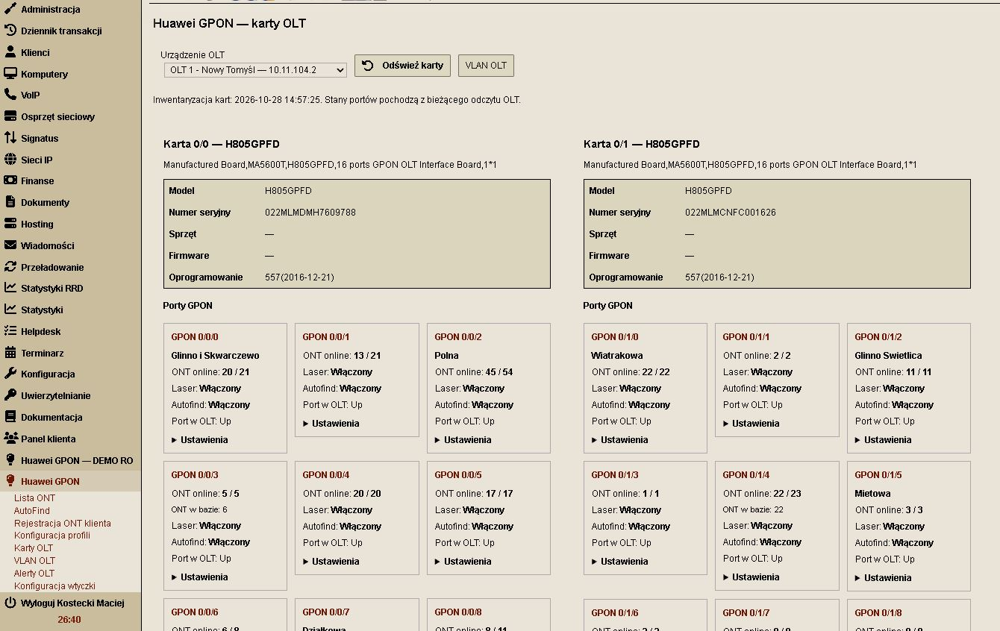
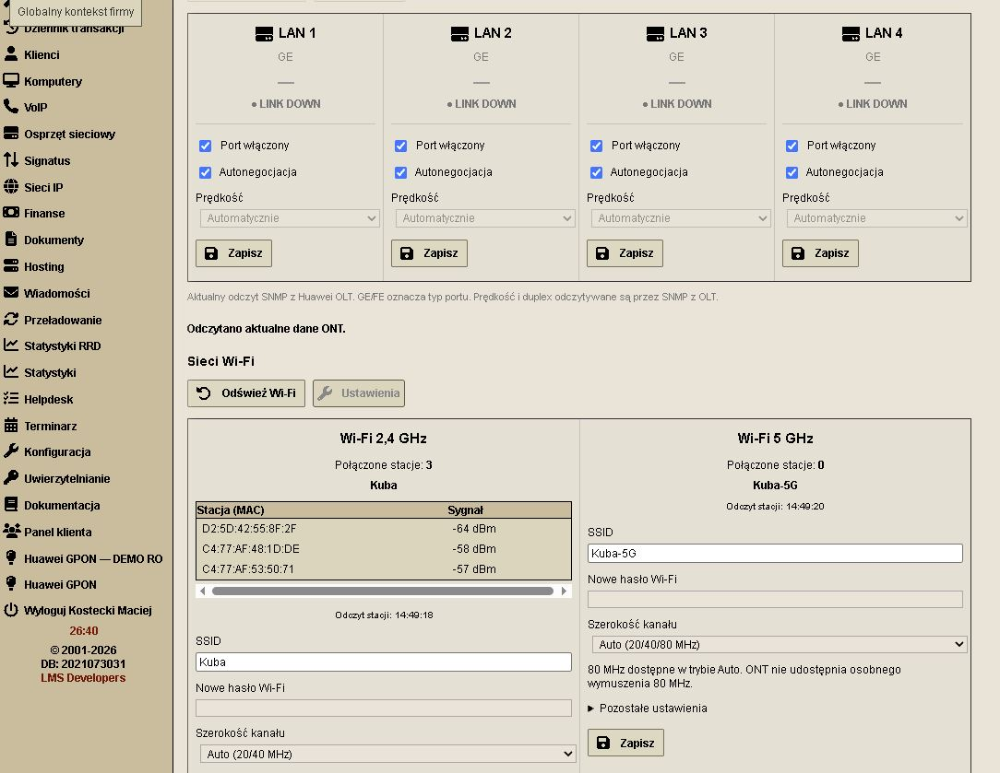
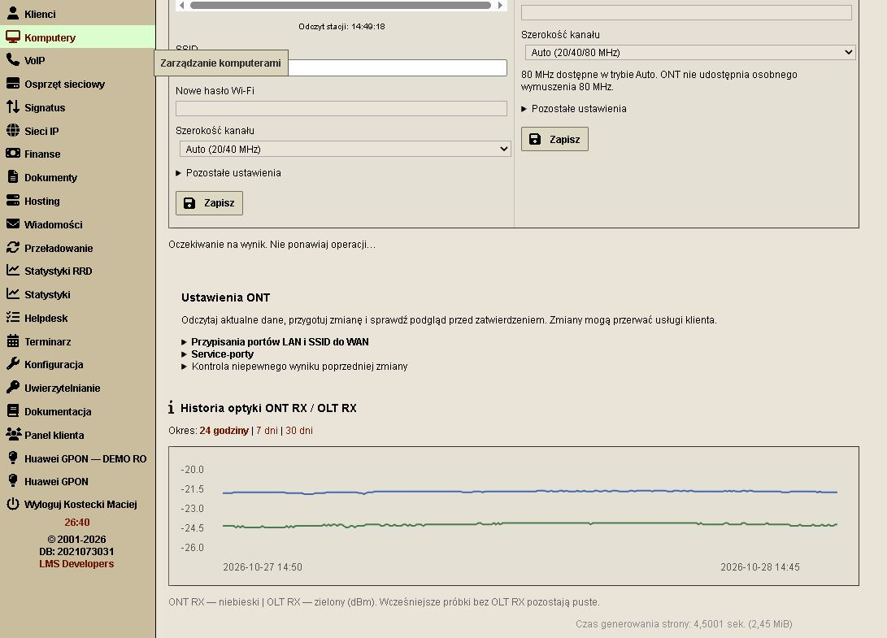

# Wtyczki LMS

Zestaw niezależnych wtyczek do LMS/LMS+: rozliczenia, powiadomienia, Huawei GPON DEMO RO i personalizacja wyglądu panelu.

| Katalog | Wtyczka | Wersja |
| --- | --- | --- |
| `plugins/NET24KsefErstePlugin` | Eksport przelewów KSeF do Erste | Brak deklaracji wersji |
| `plugins/LMSNotifyPanelPlugin` | Płatności i blokady | 0.8.4 |
| `plugins/LMSGponHuaweiDemoPlugin` | Huawei GPON — DEMO RO | 1.1.0-demo-ro-lite |
| `plugins/LMSThemeSwitcherPlugin` | Motywy LMS — kolory i układ panelu | 2.0.1 |

## Motywy LMS

12 gotowych motywów, własne kolory, wybór czcionki, trzy gęstości widoku, regulowana szerokość menu i przyklejone nagłówki tabel. Ustawienia są dostępne w **Konfiguracja → Motywy LMS** i zapisywane osobno dla operatora w przeglądarce. Wtyczka działa bez edycji kodu źródłowego LMS i nie wymaga migracji bazy.

[Opis funkcji i instrukcja instalacji Motywów LMS](plugins/LMSThemeSwitcherPlugin/README.md).

## Instalacja

Każdy katalog w `plugins/` stanowi oddzielną wtyczkę. Umieść wybrany katalog w katalogu `plugins/` swojej instalacji LMS, zachowując jego nazwę. Następnie skonfiguruj i włącz wtyczkę w LMS zgodnie z jej dokumentacją. Wtyczki mogą wymagać migracji bazy, dodatkowej konfiguracji i zadań cyklicznych; samo skopiowanie plików nie oznacza zakończenia instalacji.

- [Płatności i blokady — instrukcja](plugins/LMSNotifyPanelPlugin/README.md)
- [Huawei GPON DEMO RO — instrukcja](plugins/LMSGponHuaweiDemoPlugin/README.md)
- [Huawei GPON DEMO RO — opis wariantu](plugins/LMSGponHuaweiDemoPlugin/DEMO-VERIFICATION.md)

Eksport Erste korzysta z faktur zakupowych KSeF; rachunki nadawcy są konfigurowane w `lms.ini`. Kod znajduje się w `plugins/NET24KsefErstePlugin/`.

Repozytorium zawiera kod i pliki przykładowe. Konfiguracja instalacji LMS, hasła, klucze, dane klientów, eksporty przelewów i kopie bazy nie są częścią repozytorium.

## Zrzuty ekranu

Widoki demonstracyjne przygotowano z szablonów wtyczek z fikcyjnymi danymi. Galerie zawierają również zrzuty z instalacji przekazane przez autora, w tym kartę klienta testowego wtyczki powiadomień i widoki pełnej wersji Huawei GPON. Wygląd zależy od motywu i wersji LMS.

### Płatności i blokady

W karcie klienta dostępne są ręczne powiadomienia e-mail, e-mail z historią i SMS oraz opcjonalne odliczanie do blokady. Potwierdzenie doręczenia SMS jest widoczne niezależnie od odliczania i automatycznej blokady. Zrzut przekazany przez autora przedstawia konto testowe.

### Eksport przelewów Erste

### Huawei GPON DEMO RO

### Pełna wersja Huawei GPON — poza zakresem demo

Pełna wersja udostępnia dodatkowo Auto Find i rejestrację ONT, konfigurację usług i WAN oraz zarządzanie portami LAN i Wi-Fi. Poniższy widok przedstawia pełną wersję; jej kod nie jest częścią tego repozytorium. Szczegóły i pozostałe widoki: [README Huawei](plugins/LMSGponHuaweiDemoPlugin/README.md#pelna-wersja-huawei-gpon).

![Pełna wersja Huawei — WAN i porty LAN, funkcje niedostępne w demo]

Rejestracja ONT klienta, informacje o urządzeniu i menu pełnej wersji Huawei:

#### Nowa galeria pełnej wersji Huawei GPON

Dodano 12 zrzutów prezentujących rejestrację ONT z postępem operacji, profile ONT i service profile, karty GPON i uplink, alerty OLT, filtrowanie listy ONT, diagnostykę i powiązanie z LMS, WAN, LAN, Wi-Fi oraz historię optyki.

[Zobacz wszystkie 12 widoków z opisami](plugins/LMSGponHuaweiDemoPlugin/README.md#galeria-pełnej-wersji--widoki-z-instalacji).

## Wsparcie rozwoju

Jeśli wtyczki są dla Ciebie przydatne, możesz dobrowolnie wesprzeć ich dalszy rozwój:

[☕ Postaw kawę — wesprzyj rozwój wtyczek LMS](https://buycoffee.to/kostek_mostek)

Wsparcie jest dobrowolne i nie stanowi opłaty za instalację ani gwarancji pomocy technicznej.
