# Huawei GPON — DEMO RO

Samodzielna wtyczka demonstracyjna obok pełnej wersji. Ma własne menu, moduły, uprawnienia i tabele `huawei_gpon_demo_*`.

Zakres demo: **Lista ONT**, **VLAN OLT**, **Alerty OLT** oraz niezbędna **Konfiguracja wtyczki**. Nie ma Auto Find, rejestracji klienta, szczegółów ONT/WAN, service-portów ani profili.

Demo odczytuje OLT przez SNMP. Nie zawiera kodu zmiany konfiguracji OLT/ONT: rejestracji, restartu, resetu, usuwania ONT, konfiguracji WAN, zmian VLAN ani profili. Moduły i przyciski usuniętych funkcji nie są dostarczane. Usuwanie OLT na stronie konfiguracji usuwa tylko lokalne dane demo.

Community RO jest zapisywane **jawnie w bazie**, bez szyfrowania i pliku klucza. Jest maskowane w formularzu, nie wraca do HTML ani logów. Zmianę konfiguracji odczytu i usuwanie lokalnego OLT może wykonać tylko administrator LMS (`full_access`), z ochroną CSRF. Dane dostępowe PostgreSQL nadal pochodzą z systemowej konfiguracji LMS.

Wersja: `1.1.0-demo-ro-lite`.

## Instalacja

1. Umieść katalog `LMSGponHuaweiDemoPlugin` w `/var/www/html/lms/plugins/`.
2. W katalogu głównym LMS uruchom `composer dump-autoload --optimize --no-scripts --no-interaction`. Wtyczkę włącz po utworzeniu schematu bazy w kroku 4.
3. Wymagane: PHP CLI i WWW 8.0+, PDO PostgreSQL, SNMP, DOM i zlib, net-snmp (`snmpget`, `snmpbulkwalk`), coreutils (`timeout`, `flock`), `setfacl`, `runuser`, Python 3, cron i logrotate. Konto bazy musi móc utworzyć tabele podczas instalacji.
4. Po wykonaniu kopii bazy uruchom `php /var/www/html/lms/plugins/LMSGponHuaweiDemoPlugin/bin/demo-db.php schema`. Następnie włącz `LMSGponHuaweiDemoPlugin` w konfiguracji wtyczek LMS.
5. Otwórz **Huawei GPON — DEMO RO → Konfiguracja wtyczki**. Dodaj OLT z nazwą i IPv4. W sekcji Dostęp SNMP zapisz community RO, a w Ustawieniach urządzenia zaznacz aktywne odczyty i zapisz. Nie potrzeba pliku JSON ani klucza szyfrowania.
6. Jako root uruchom `bash /var/www/html/lms/plugins/LMSGponHuaweiDemoPlugin/bin/install-collectors.sh`. Instalator tworzy konto `lms-huawei-demo`, nadaje mu odczyt konfiguracji LMS i instaluje harmonogram czterech kolektorów oraz rotację logów. Domyślne ścieżki odpowiadają LMS w `/var/www/html/lms`.
7. Pierwszy odczyt wykonaj kolejno skryptami `collect-inventory.php`, `collect-onts.php`, `collect-status.php`. Przykład: `runuser -u lms-huawei-demo -- flock -n /var/lib/lms-huawei-demo-collector/collector.lock php /var/www/html/lms/plugins/LMSGponHuaweiDemoPlugin/bin/collect-inventory.php`. Kolejne odczyty wykonuje cron. Logi: `/var/log/lms-huawei-demo/`.

Przy równoległej pełnej wersji kolektory współdzielą blokadę odczytu, aby nie odpytywać OLT równocześnie. Odczyty zapisują historię wyłącznie w lokalnej bazie demo; RO dotyczy urządzenia, nie bazy LMS.

## Alerty i udostępnianie

Alerty wymagają odbiornika trapów i bezpiecznego eksportu do `/var/lib/lms-huawei-alerts/alerts.json`, czytelnego dla serwera WWW. Przykład formatu: `config/alerts.example.json`. Nie zapisuj community ani surowych nagłówków trapów w eksporcie.

Archiwum nie zawiera bazy, prawdziwych community, danych klientów ani konfiguracji tego serwera. Dostęp do działającego demo może pokazywać rzeczywiste dane lokalnej instalacji. Szczegóły sprawdzeń: `DEMO-VERIFICATION.md`.

## Zrzuty ekranu demo

Widoki dokumentacyjne powstały z szablonów wtyczek z fikcyjnymi danymi. Adresy z zakresu `192.0.2.0/24`, numery seryjne, SSID i parametry nie opisują rzeczywistej sieci. Wygląd zależy od motywu i wersji LMS.

Lista ONT w demo: filtrowanie, status połączenia, poziomy optyczne, odległość i odświeżanie odczytu.

### Menu demo

Menu DEMO RO zawiera: Lista ONT, VLAN OLT, Alerty OLT i Konfiguracja wtyczki.

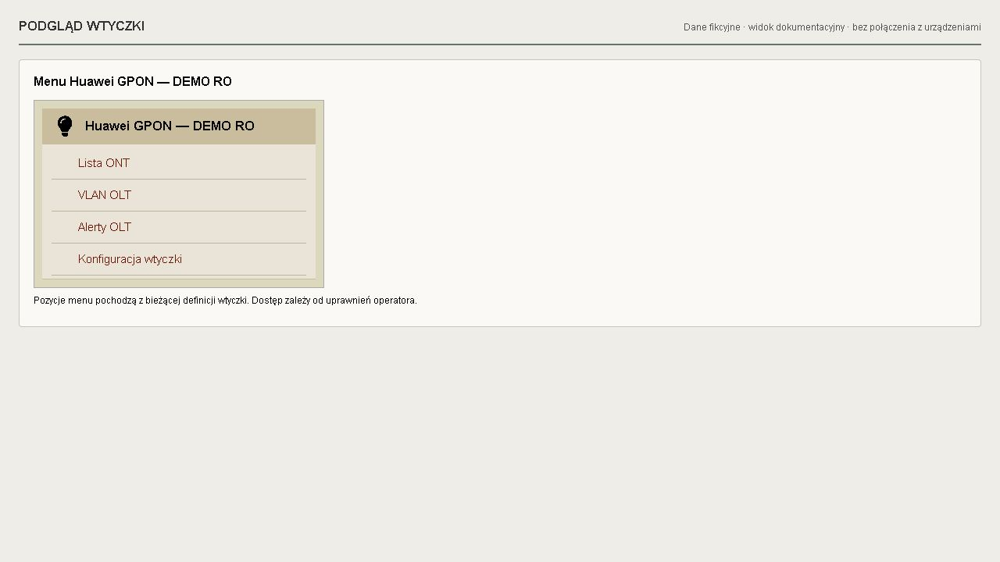

## Pełna wersja Huawei GPON

**Poniższe zrzuty pokazują pełną wersję Huawei GPON. Przedstawione dodatkowe funkcje nie są dostępne w DEMO RO, a kod pełnej wersji nie jest dołączony do tego repozytorium.**

### Auto Find i rejestracja ONT

Wykrywanie niezarejestrowanych ONT, wybór terminala, dobór profili line/service, opis urządzenia oraz przygotowanie rejestracji z usługami Internet i opcjonalnie IPTV.

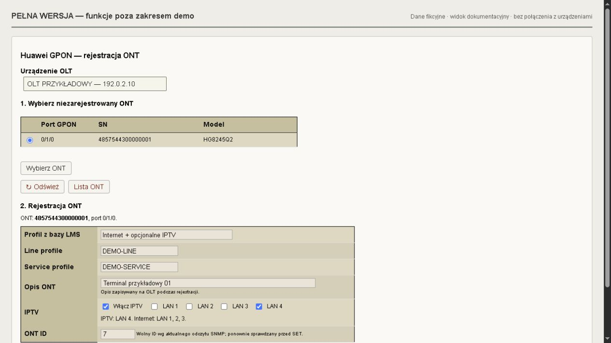

### Rejestracja ONT klienta

Osobny formularz pozwala wybrać abonenta LMS, nadać opis ONT, wskazać profil usług i ONT ID oraz uruchomić rejestrację z konfiguracją usług. Na zrzucie pokazano cały formularz dla wcześniej wybranego terminala.

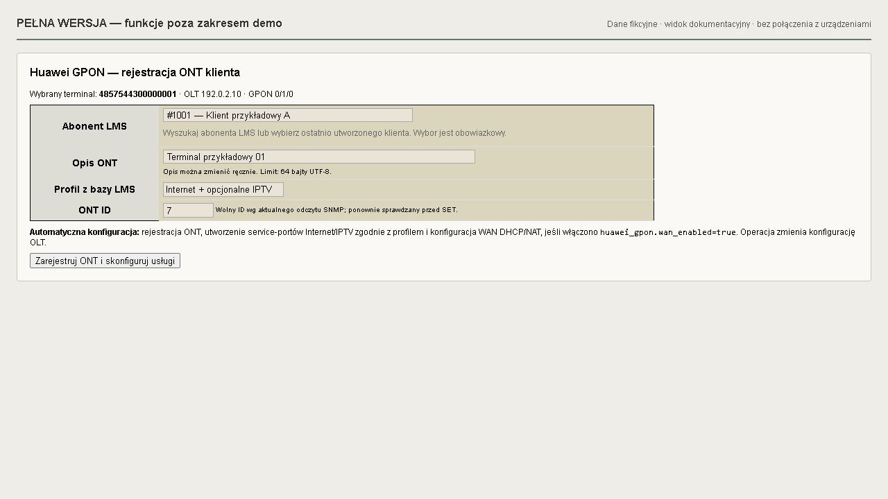

### Informacje o ONT

Strona urządzenia pokazuje status, opis, poziomy optyczne ONT RX i OLT RX, OLT, port GPON, identyfikator ONT, numer seryjny, profile oraz parametry diagnostyczne. Dalsze sekcje tej strony obejmują abonenta LMS, WAN, LAN, Wi-Fi i historię optyki. Dostępność danych i operacji zależy od modelu i uprawnień.

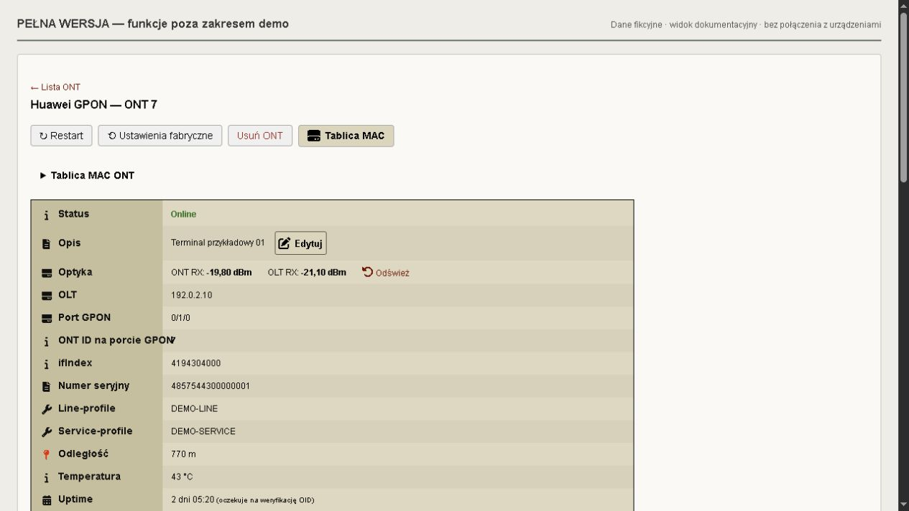

### Menu pełnej wersji

Menu zawiera: Lista ONT, AutoFind, Rejestracja ONT klienta, Konfiguracja profili, Karty OLT, VLAN OLT, Alerty OLT i Konfiguracja wtyczki.

### WAN i porty Ethernet

Pełna wersja pokazuje parametry WAN, adresację, VLAN i porty LAN z ich stanem, prędkością oraz duplexem. Udostępnia również operacje konfiguracji urządzenia, zależne od modelu, uprawnień i ustawień zapisu.

### Wi-Fi 2,4 GHz i 5 GHz

Podgląd SSID i liczby połączonych stacji oraz dostęp do ustawień Wi-Fi. Obsługiwany zakres odczytu i konfiguracji zależy od modelu ONT i jego oprogramowania.

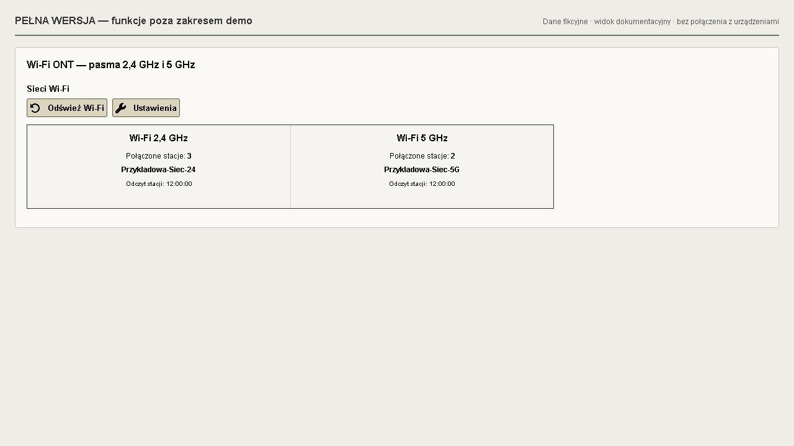

### Galeria pełnej wersji — widoki z instalacji

Poniższe zrzuty zostały przekazane przez autora i przedstawiają widoki pełnej wersji w różnych motywach LMS. Funkcje konfiguracji i sterowania zależą od modelu urządzenia, oprogramowania oraz uprawnień operatora.

#### Historia optyki i ustawienia ONT

Wykres poziomów ONT RX i OLT RX dla okresów 24 godziny, 7 dni i 30 dni oraz dostęp do przypisań LAN/SSID do WAN i service-portów.

#### Rejestracja ONT — przebieg operacji

Wybór sieci i wolnego adresu IP komputera LMS, opcjonalne IPTV i porty Ethernet oraz podgląd kolejnych etapów rejestracji ONT.

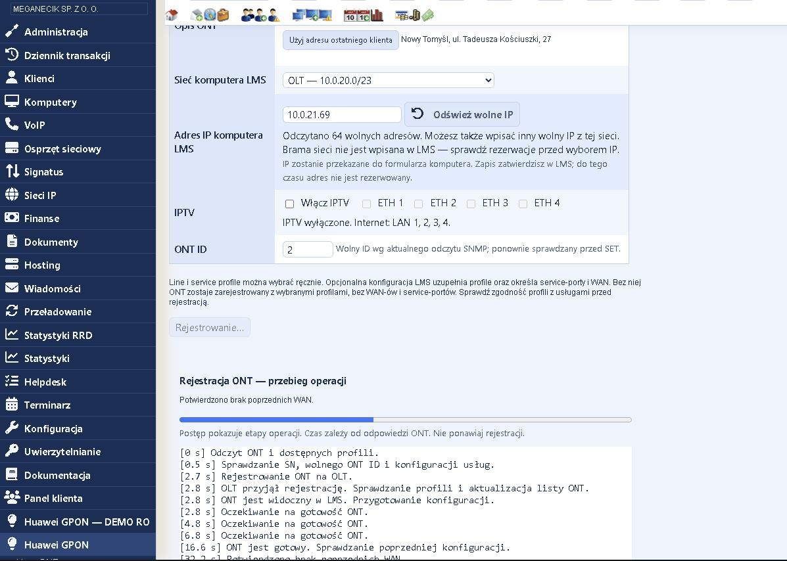

#### Profile ONT zapisane w LMS

Lista profili rejestracji i konfiguracji WAN z przypisanymi profilami line/service oraz oznaczeniem aktywności.

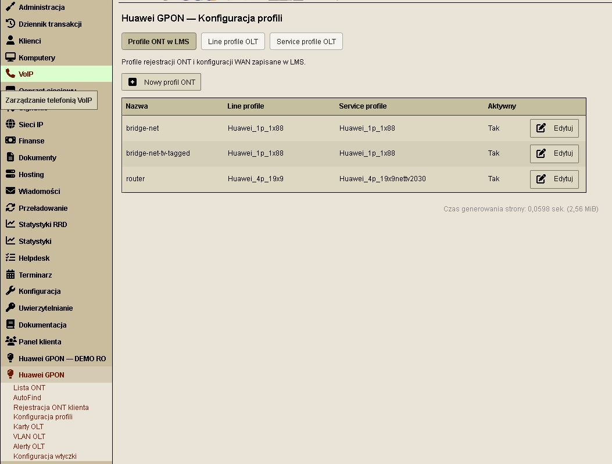

#### Konfiguracja profilu routera

Dobór OLT i profili Huawei, trybu połączenia, VLAN Internet, NAT oraz opcjonalnych parametrów IPTV. Zapis profilu w LMS nie zmienia istniejących ONT.

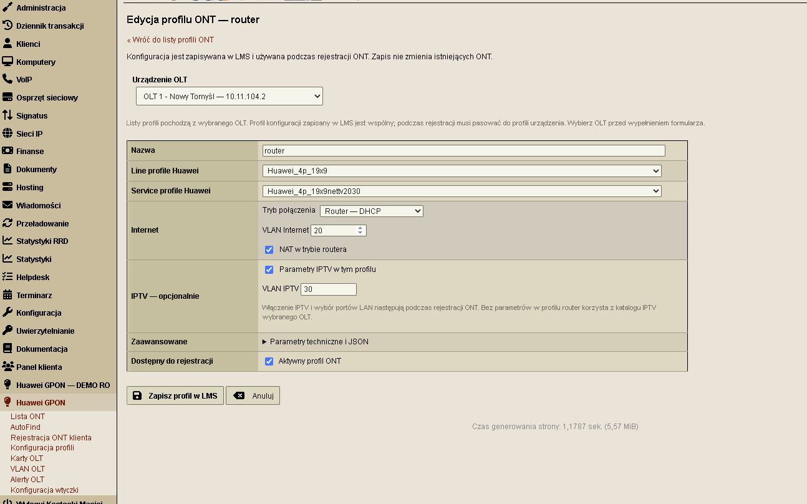

#### Service profile na OLT

Odczyt profili z wybranego OLT, liczba powiązanych ONT oraz dostęp do tworzenia i edycji profili.

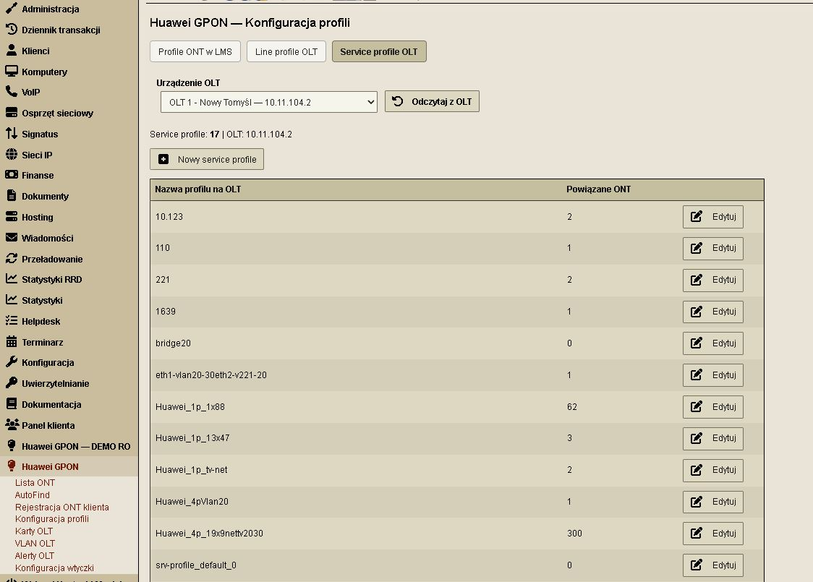

#### Alerty OLT

Historia zdarzeń z filtrowaniem według urządzenia i typu zdarzenia, czasem odbioru, kategorią, opisem i powiązaniem z portem GPON lub ONT.

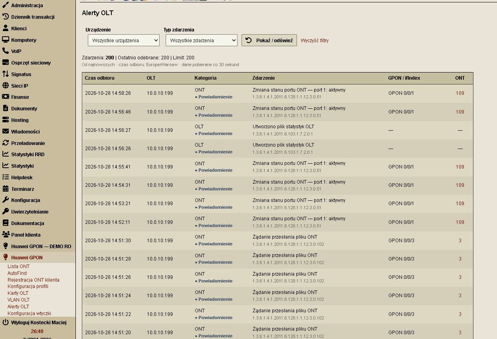

#### Karty OLT i porty GPON

Inwentaryzacja kart, dane sprzętowe i oprogramowanie, liczba ONT online oraz stan portów, lasera i Auto Find.

#### Karty sterujące i uplink

Podgląd kart sterujących i uplink, stanu łączy, modułów i prędkości interfejsów. Zakres sterowania zależy od rozpoznania karty i portu.

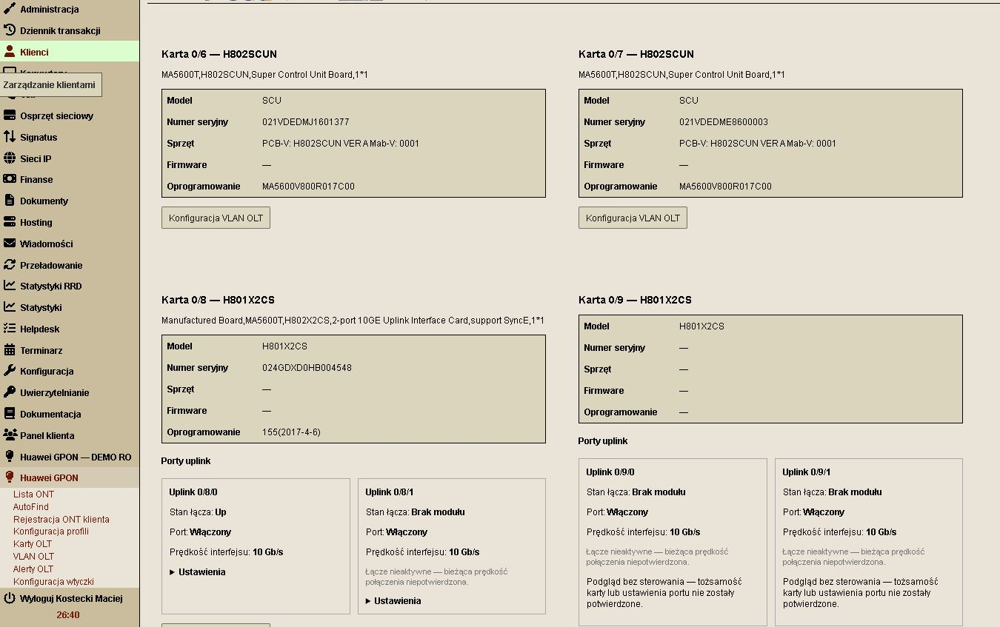

#### Lista ONT i filtrowanie portów

Filtrowanie według OLT, slotu i portu GPON oraz numeru seryjnego, opisu lub ONT ID. Lista portów pokazuje opisy i liczbę ONT.

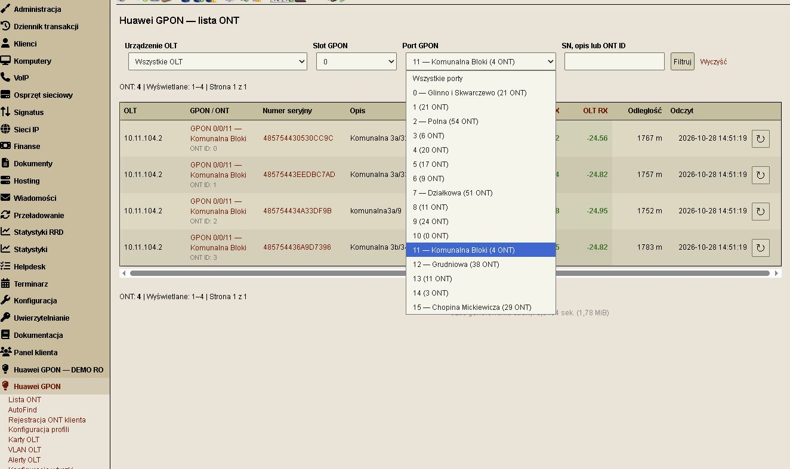

#### Diagnostyka ONT i powiązanie z LMS

Status, optyka, odległość, temperatura, profile i identyfikatory urządzenia oraz powiązanie z klientem i komputerem LMS. Dostępne operacje obejmują restart, ustawienia fabryczne, usunięcie ONT i tablicę MAC.

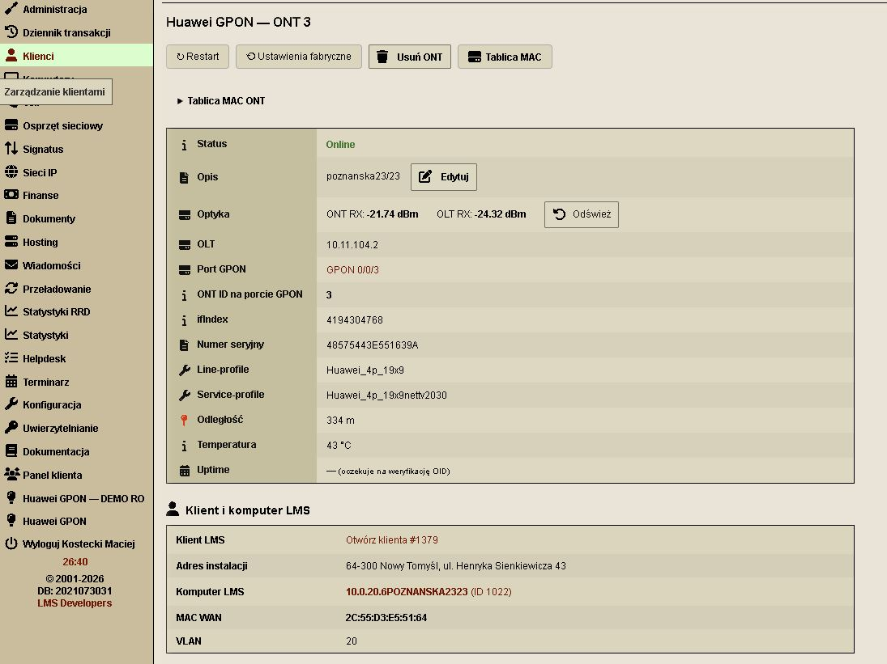

#### WAN, porty Ethernet i stacje Wi-Fi

Odczyt parametrów WAN, adresacji i VLAN, stanu portów Ethernet oraz połączonych stacji Wi-Fi wraz z poziomem sygnału.

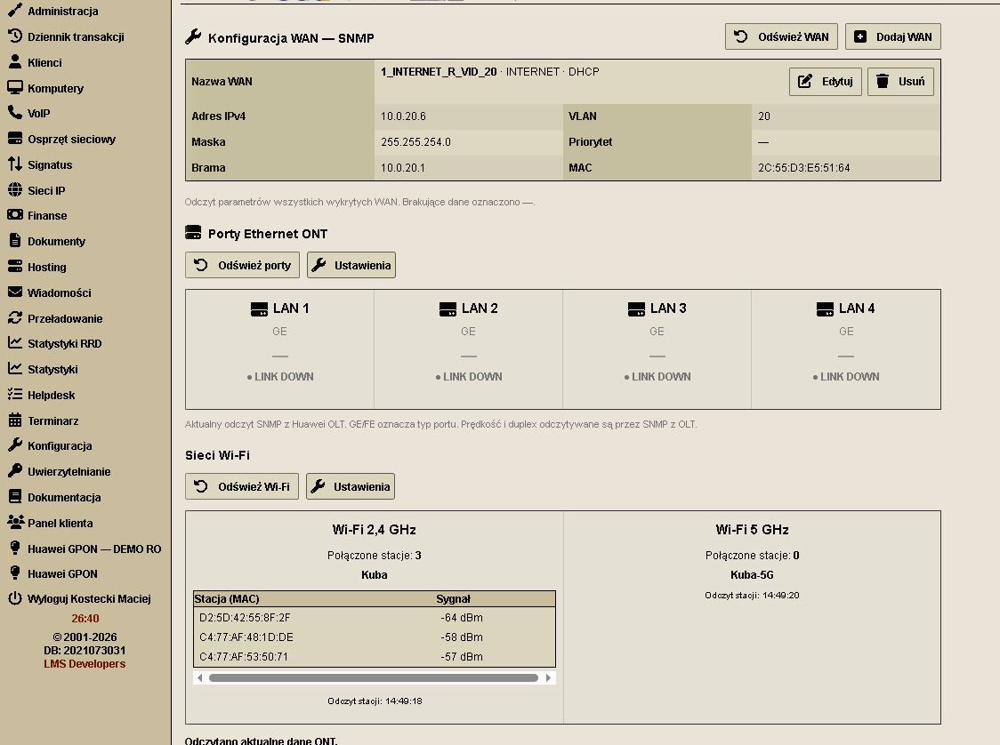

#### Ustawienia LAN i Wi-Fi

Włączanie portów LAN, autonegocjacja i prędkość oraz ustawienia SSID, nowego hasła i szerokości kanału dla pasm 2,4 GHz i 5 GHz. Dostępność funkcji zależy od modelu ONT i oprogramowania.

### Integracja pełnej wersji GPON z kartą klienta i komputera LMS

W sekcji **Komputery klienta** przy powiązanym urządzeniu ONT pojawia się odnośnik **Przejdź do ONT**, prowadzący do jego szczegółów w pełnej wersji wtyczki Huawei GPON.

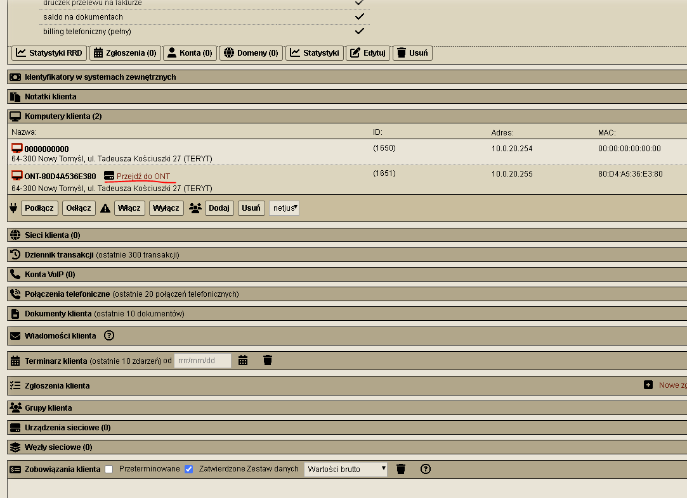

W karcie komputera panel **ONT Huawei GPON** pokazuje status z inwentaryzacji, ONT ID, poziomy optyczne **ONT RX** i **OLT RX** oraz czas pomiaru. Odnośnik **Przejdź do ONT** pozwala otworzyć szczegóły terminala bez wyszukiwania go na liście ONT. Poniższy widok pokazuje również standardowe dane komputera LMS: sieć, adres IP, MAC i lokalizację.

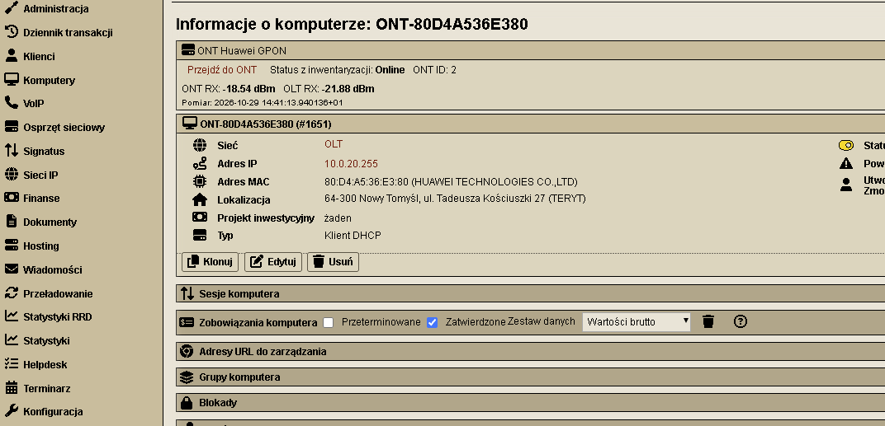

Te widoki dotyczą pełnej wersji GPON; kod tej wersji nie jest dołączony do pakietu DEMO RO.

## Wsparcie rozwoju

Jeśli wtyczki są dla Ciebie przydatne, możesz dobrowolnie wesprzeć ich dalszy rozwój:

[☕ Postaw kawę — wesprzyj rozwój wtyczek LMS](https://buycoffee.to/kostek_mostek)

Wsparcie jest dobrowolne i nie stanowi opłaty za instalację ani gwarancji pomocy technicznej.
