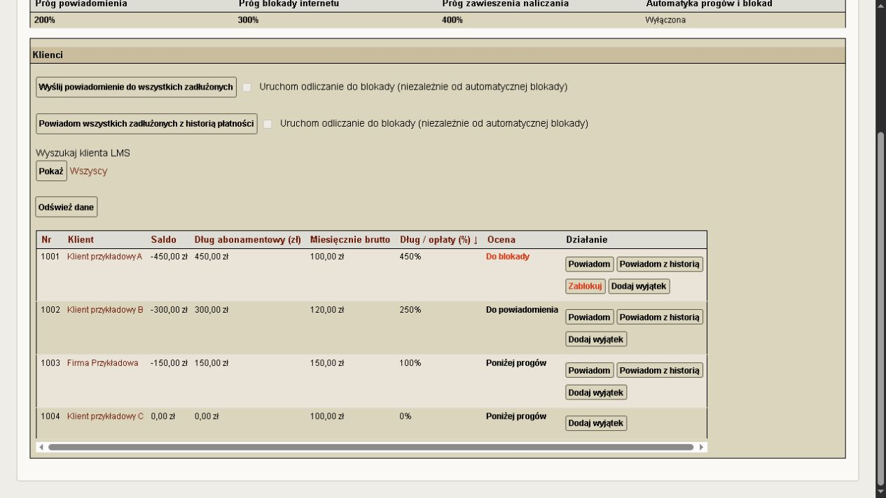
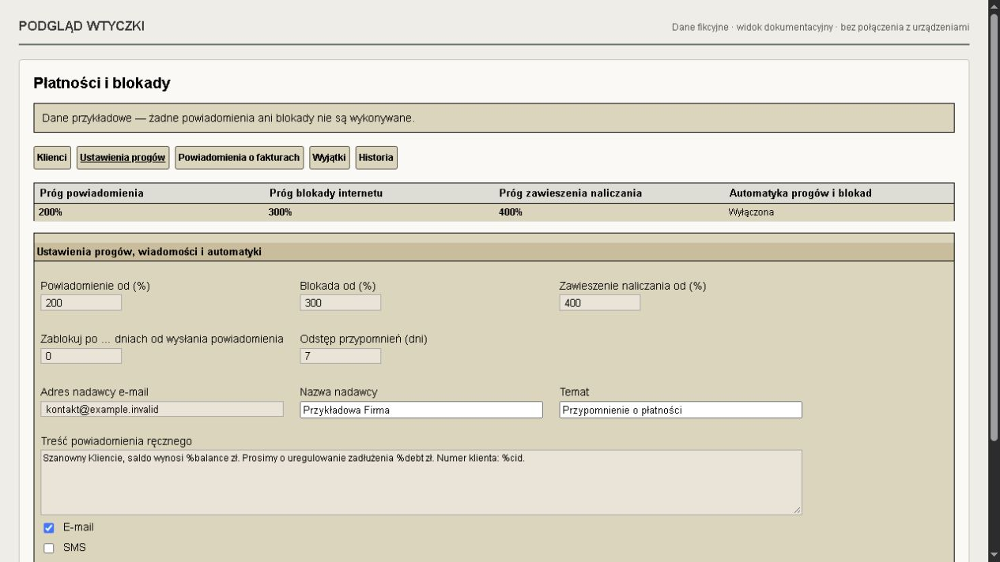

# Płatności i blokady — LMSNotifyPanelPlugin 0.7.4

Wtyczka do LMS Plus. Bez zmian plików źródłowych LMS i bez zależności od wtyczki Huawei.

## Ocena i szybkość listy

Kolumna „Ocena” pokazuje ostatnie powiadomienie zapisane przez wtyczkę, z datą i godziną: „Wysłano powiadomienie”, „Wysłano powiadomienie z historią” lub powiadomienie o fakturze. Błędy i niepotwierdzony wynik mają osobne oznaczenia. „Wysłano” oznacza przyjęcie do wysyłki; doręczenie można sprawdzić w historii wiadomości LMS.

Odczyt listy pobiera dane partiami zamiast powtarzać pełne zapytania dla każdego klienta. Obliczenia zachowują rabaty, VAT, ilości i podział długu; sprawdzono zgodność wszystkich pól dla 1281 klientów. Wykonanie operacji nadal sprawdza świeże dane natywnymi metodami LMS. Zmierzony czas pełnej strony: 1,4600 s zamiast około 8 s.

## Notatki, kontakt i wyjątki na liście

Na liście pokazujemy także pole „Informacje” z karty klienta (`customers.info`), pod osobną etykietą. To tutaj może być zapisany kontakt SMS i deklarowany termin wpłaty. Jest to wyłącznie podgląd tekstu — nie tworzy automatycznie wyjątku ani nie zmienia kwalifikacji powiadomień.

Na liście skrócono przycisk do „Powiadom z historią”. Przyciski powiadomień pozostają w jednym wierszu bez zawijania; poniżej są blokowanie/odblokowanie i obsługa wyjątków. Potwierdzenie wysyłki i działanie załącznika historii pozostają bez zmian.

Przyciski w kolumnie „Działanie” mają wysokość 22 px zamiast 30 px. Zmiana dotyczy wyłącznie ich wymiarów, bez zmiany czcionki, kolorów lub wykonywanych operacji.

Przyciski w kolumnie działań są ułożone w dwóch wierszach: u góry „Powiadom” i „Powiadom z historią płatności”; poniżej „Zablokuj” (czerwony napis, bez zmiany tła) lub „Odblokuj” oraz przyciski wyjątków w standardowych kolorach LMS. Reguły dostępności działań pozostają bez zmian.

Przy nazwie klienta pokazujemy treść pola „Notatki” z karty oraz ostatni wpis z historii notatek z datą, jeżeli taki wpis istnieje i różni się od treści pola. Notatki są wyświetlane jako bezpieczny tekst z zachowanymi podziałami wierszy. Dane są odczytywane dla widocznej strony przy jej otwarciu; nie są dołączane do wiadomości klientów i nie zmieniają automatycznie wyjątków.

Brak wpisanego adresu oznaczony jest jako „Brak e-maila”. Osobne oznaczenia informują o nieprawidłowym adresie, wyłączonym kontakcie, braku zgody albo braku oznaczenia do powiadomień. Wyświetlanie statusu nie zmienia zasad kwalifikacji wiadomości.

Domyślna kolejność po otwarciu listy bez parametrów sortowania: „Dług / opłaty (%)” malejąco. Klienci bez wyliczonego procentu są na końcu. Ręcznie wybrane sortowanie nadal działa.

W kolumnie „Działanie” znajduje się przycisk „Dodaj wyjątek”, który otwiera zakładkę „Wyjątki” z wybranym klientem, bez zapisywania wyjątku. Dla istniejącego wyjątku wtyczki w tej kolumnie wyświetlane są opis, „Zmień wyjątek” i „Usuń wyjątek”. Usunięcie wraca do tej samej strony listy i zachowuje sortowanie oraz filtr klienta. Przycisk usuwania jest też w zakładce „Wyjątki”. Nie usuwa osobnej ochrony cutoffstop w LMS. Samo kliknięcie „Dodaj” lub „Zmień” niczego nie zapisuje — formularz trzeba zatwierdzić.

Zasady: dług z opłat cyklicznych podzielony przez miesięczne opłaty brutto po rabatach. Powiadomienie od **200%**, blokada internetu od **300%**, zawieszenie naliczania od **400%**, łącznie z granicą. Wszystkie progi są konfigurowalne. Opłaty jednorazowe za urządzenia i pojedyncze usługi są wyłączone z obydwu progów. Całe saldo pozostaje widoczne oddzielnie. Pod uwagę brane są już zaksięgowane obciążenia (także przed terminem płatności), nie przyszłe planowane naliczenia.

Rodzaj pozycji faktury wynika z `invoicecontents.period`: 0 — jednorazowa, okres dodatni — cykliczna. Daty od–do oraz okres zobowiązania określają aktywność miesięcznej podstawy; 0 w dacie oznacza brak granicy. Dzień naliczania obsługuje istniejący mechanizm LMS (0 przy miesięcznej opłacie oznacza ostatni dzień miesiąca). Niepowiązane z dokumentem wpłaty są rozliczane FIFO, od najstarszych obciążeń. Kredyty wskazujące konkretny dokument rozliczają go w pierwszej kolejności. Jest to sposób analitycznego podziału salda w panelu, bez przepisywania wpłat w LMS. Nierozpoznane pozostałe obciążenia lub niezgodność sumy z saldem powodują ręczną weryfikację i wyłączenie działań automatycznych.

Miesięczne opłaty pochodzą z pola `discounted_value` metody LMS `GetCustomerAssignments`: jest to kwota brutto po rabatach, VAT i uwzględnieniu liczby usług. Uwzględniane są tylko aktywne, zatwierdzone i niezawieszone zobowiązania, a opłaty kwartalne/półroczne/roczne są przeliczane na miesiąc. Nie używamy `GetCustomerAssignmentValue`, ponieważ dla taryf rozliczanych od netto może odwoływać się do nieaktualnej wartości brutto taryfy. Saldo: `getCustomerBalance(id, null, false)`. Używana instalacja referencyjna: `v27.63-3203-g74d33e49ac`, PostgreSQL. Klienci aktywni (`CSTATUS_CONNECTED`), niezarchiwizowani. Obce waluty, brak dodatnich opłat i nietypowe okresy rozliczeniowe wymagają ręcznej weryfikacji.

## Funkcje

- Pozycja „Finanse → Płatności i blokady”, lista z paginacją i wyszukiwaniem numeru klienta, indywidualne saldo i procent długu. Wygląd korzysta z natywnych klas LMS, bez własnej palety kolorów.
- Zakładki u góry: Klienci, Ustawienia progów, Powiadomienia o fakturach, Wyjątki, Historia. Domyślna kolejność: największy dług abonamentowy jako pierwszy. Sortowanie przez nagłówki: numer, klient, saldo, dług w zł, opłaty miesięczne, procent długu i ocena. Sortowanie obejmuje pełną listę przed podziałem na strony. Lista przechowywana w sesji administratora do 60 sekund; przycisk „Odśwież dane” odczytuje ją ponownie. Operacje zawsze ponownie sprawdzają bieżące dane.
- Edytowalne progi, wiadomości i kanały e-mail/SMS; podstawienia `%cid`, `%customername`, `%balance`, `%debt`, `%monthly`, `%percent`.
- Podgląd i osobne jednorazowe zatwierdzenie operacji dla jednego klienta, ponowna kwalifikacja przy wykonaniu.
- Historia operacji, wyjątki czasowe z powodem, respektowanie `cutoffstop`.
- Wysyłka przez `LMS->SendMail` / `LMS->SendSMS`, rejestracja w standardowej historii wiadomości. Respektowane zgody mailingnotice/smsnotice oraz aktywne kontakty typu powiadomienia. Domyślnie odstęp przypomnień 7 dni na klienta i kanał.
- Blokada przez `LMS->NodeSet(id,0)`, tylko urządzenia dotąd aktywne. Po osiągnięciu osobnego progu zawieszenia naliczania (domyślnie 400%) zawiesza aktywne cykliczne zobowiązania przez `LMS->SuspendAssignment`; nie zmienia opłat jednorazowych, taryf, statusu klienta ani konfiguracji ONT/OLT/SNMP. Zapis blokady i zawieszenia odbywa się w jednej transakcji. Niezerowe `finances.suspension_percentage` uniemożliwia operację obejmującą zawieszenie naliczania, bo nie zapewnia całkowitego zatrzymania opłat; sama blokada internetu poniżej tego progu nie wymaga zawieszenia. Nie zmieniamy tego globalnego ustawienia.
- Odblokowanie po spłacie długu abonamentowego, wyłącznie urządzeń z rejestru blokad tej wtyczki, wraz ze wznowieniem tylko jej własnych zawieszeń naliczania. Wcześniejsze ręczne zawieszenia pozostają bez zmian. Podstawa miesięczna zawieszonych przez wtyczkę zobowiązań jest zapamiętana, żeby nie znikała przy obliczaniu procentu długu. Domyślnie wyłączone automatyczne odblokowanie.
- Harmonogram CLI: bez `--apply` podgląd, z `--apply` tylko działania włączone w panelu. Wszystkie automatyczne działania początkowo wyłączone.

## Ręczna wysyłka do zadłużonych

Szablon w „Ustawieniach progów” służy do ręcznego powiadamiania pojedynczego klienta oraz wysyłki zbiorczej. Przy ręcznej wysyłce wystarczy dodatni dług abonamentowy, bez osiągania 200%. Automatyczne powiadomienia procentowe, jeżeli zostaną osobno włączone i zaplanowane, także korzystają z tego szablonu, z zachowaniem progu 200%.

Przycisk „Wyślij powiadomienie do wszystkich zadłużonych” na liście klientów przygotowuje podgląd dla całej listy, niezależnie od filtra i numeru strony. Obejmuje aktywnych klientów z długiem abonamentowym >0 zł. Pomija wyjątki, przypadki wymagające weryfikacji, brak zgód lub aktywnego kontaktu oraz wiadomości w okresie ochronnym od ostatniej wysyłki. Opłaty jednorazowe nie kwalifikują samodzielnie do wysyłki.

Podgląd zawiera liczbę i listę odbiorców, liczbę pominięć oraz przykład wiadomości. Dopiero przycisk „Potwierdź wysyłkę…” tworzy zadanie ręczne. Pozostaw stronę otwartą — wykonuje małe partie i pokazuje postęp. Zadanie można zatrzymać, a po zamknięciu strony wznowić z listy „Twoje ostatnie wysyłki”. Brak osobnego zadania cron do ręcznych wysyłek. Ponowne otwarcie zakończonego zadania nie ponawia wiadomości. Wynik przerwany lub niepewny wymaga sprawdzenia standardowej historii LMS i nie jest automatycznie ponawiany. Przed każdym odbiorcą sprawdzane są aktualny dług, wyjątki, zgody, odstęp i wersja ustawień. Zmiana ustawień zatrzymuje pozostałą kolejkę i wymaga nowego podglądu. Zadanie jest dostępne tylko operatorowi, który je zatwierdził.

Symbole ręczne: `%name` i `%customername` — nazwa klienta; `%balance` — całe saldo konta, ze znakiem minus przy zadłużeniu i z uwzględnieniem opłat jednorazowych; `%debt` — dodatnia kwota długu abonamentowego; `%bankaccount` — indywidualny rachunek wyznaczony mechanizmem LMS; `%cid`, `%monthly`, `%percent`. Dopisz „zł” do kwoty. `%unpaid` pozostaje symbolem pozostałej kwoty konkretnej faktury i nie jest obsługiwany w szablonie ręcznym.

Dodano wyłącznie własne tabele `lnp_bulk_jobs` i `lnp_bulk_items`. Przy aktualizacji wykonaj `php plugins/LMSNotifyPanelPlugin/bin/run.php --upgrade-schema --config-file=/etc/lms/lms.ini`. Polecenie tylko uzupełnia schemat, nie wysyła wiadomości. Pełna nowa instalacja CLI również tworzy te tabele.

## Mechanizm powiadomień LMS

Standardowy typ `debtors` wybiera zaległe saldo klienta. Wtyczka nie używa go do powiadomień po terminie. Nie edytuje `bin/lms-notify.php`. Zakładka pozwala edytować sekcje `notify-reminder`, `notify-overdue`, `notify-overdue-7` przez globalne wpisy `uiconfig`; plik `lms.ini` pozostaje bez zmian. Dotychczasowy lms-notify obsługuje tylko przypomnienie przed terminem, poprzez przełącznik i wspólny zegar wtyczki. Profile po terminie obsługuje osobny skrypt wtyczki `bin/invoice-overdue.php`.

## Bieżąca faktura i przełączniki wysyłki

Nad trzema równymi panelami znajduje się „Wspólna godzina wysyłki”, domyślnie 08:00. Zmień pole i kliknij „Zapisz godzinę”. Ustawienie `notify-panel.invoice_time` dotyczy wszystkich trzech powiadomień, w strefie Europe/Warsaw, niezależnie od czasu serwera. Zmiana godziny nie włącza wyłączonych profili. Wpisy cron sprawdzają ustawienie co minutę, ale skrypty dopuszczają wysyłkę tylko o zapisanej godzinie. Nie należy zastępować tego wpisem na stałą godzinę, bo edycja w panelu przestanie sterować czasem uruchomienia.

Profil „Przed terminem faktury” także ma przełącznik wysyłki. W działającej instalacji zachowano stan włączony. Jeden wpis uruchamia `bin/invoice-reminder.php --run`, który sprawdza godzinę oraz przełącznik i dopiero wtedy uruchamia dotychczasowy `lms-notify -s notify-reminder -t reminder`. Po odznaczeniu pola i zapisaniu formularza zadanie pomija wysyłkę. Bez `--run` skrypt jedynie sprawdza stan. Dzienny rejestr i blokada zapobiegają ponownemu przebiegowi przed terminem tego samego dnia, również po zmianie godziny. Błąd lub przerwany przebieg wymaga ręcznej weryfikacji; nie jest ponawiany automatycznie. Przy nowej instalacji użyj `cron-reminder.example` zamiast dotychczasowego wpisu przypomnienia; nie dodawaj drugiej kopii.

W zakładce „Powiadomienia o fakturach” każdy profil po terminie ma własny przełącznik „Włącz automatyczne wysyłanie tego powiadomienia”. Zaznacz go i zapisz odpowiedni formularz. Oba przełączniki są domyślnie wyłączone. Harmonogram z pliku `cron-invoices.example` należy zainstalować jako `/etc/cron.d/lms-notify-panel`; na docelowym serwerze jest już zainstalowany. Wysyłka następuje według wspólnej godziny, tylko dla włączonych profili. Nie uruchamiaj równolegle starych zadań typu `debtors` dla tych sekcji.

Powiadomienie po terminie dotyczy wyłącznie faktury VAT wystawionej w bieżącym miesiącu, z samymi pozycjami cyklicznymi. Dokumenty starsze, zamknięte, jednorazowe, mieszane, nierozpoznane oraz waluty inne niż PLN są pomijane. Bieżący miesiąc oznacza miesiąc daty wystawienia faktury. Próg 3 lub 7 dni liczy się kalendarzowo od terminu dokumentu w strefie Europe/Warsaw. Jeśli termin i próg wypadają dopiero w kolejnym miesiącu, ta faktura nie jest już objęta automatyczną wysyłką; wymaga indywidualnego kontaktu.

Wpłaty przypisane do dokumentu pomniejszają jego kwotę. Wpłaty bez wskazania faktury z bieżącego miesiąca oraz dodatnie saldo na początek miesiąca pokrywają bieżące faktury abonamentowe, w kolejności wystawienia, nawet przy starych zaległościach. Raz użyta wpłata nie jest liczona ponownie. Jest to reguła kwalifikacji wiadomości, bez przepisywania księgowań LMS. W wiadomości `%value` oznacza pełną kwotę faktury, a `%unpaid` pozostałą kwotę do zapłaty. Ta reguła nie zmienia analizy długu do progów 200%/300%, która nadal stosuje FIFO.

Skrypt bez `--apply` wyłącznie pokazuje kwalifikację. Nawet z `--apply` odmawia wysyłki przy wyłączonym `lnp_enabled`; stan jest sprawdzany ponownie bezpośrednio przed wysyłką. Każdy profil wysyła najwyżej raz na dokument. Rejestruje zamiar przed zewnętrznym wywołaniem, a wynik niepewny lub częściowy blokuje automatyczne ponowienie. Uwzględnia zgodę mailingnotice, aktywny adres e-mail oznaczony do faktur i powiadomień, wyjątki wtyczki i cutoffstop. W tej wersji profile po terminie wysyłają e-mail. Nie aktywują powiadomień procentowych ani blokad.

## Instalacja

1. Zrób backup bazy LMS oraz listy aktywnych wtyczek. Zachowaj aktualny harmonogram zadań. Sprawdź istniejące mechanizmy blokowania/odblokowywania, żeby nie działały sprzecznie.
2. Skopiuj katalog `LMSNotifyPanelPlugin` do `/var/www/html/lms/plugins/`. Pliki należą do administratora, proces WWW musi móc je czytać, bez prawa zapisu. Nie kopiuj przykładowych danych do LMS.
3. Sprawdź składnię plików PHP i uruchom `php plugins/LMSNotifyPanelPlugin/tests/policy.php`.
4. Z katalogu LMS wykonaj `php plugins/LMSNotifyPanelPlugin/bin/run.php --install-schema --config-file=/etc/lms/lms.ini`. Tworzy tabele `lnp_*` oraz stosuje dołączone migracje do wersji 0.7.4. Ponowne wykonanie odmawia nadpisania. Instalacja nie wysyła wiadomości ani nie blokuje urządzeń. Wymagane PostgreSQL oraz prawo tworzenia tabel dla konta LMS.
Przy aktualizacji istniejącej instalacji wykonaj zamiast instalacji schematu: `php plugins/LMSNotifyPanelPlugin/bin/run.php --upgrade-schema --config-file=/etc/lms/lms.ini`. Uzupełnia schemat tabel wtyczki przez dołączone migracje do wersji 0.7.4; nie wysyła wiadomości ani nie blokuje klientów. Po kopiowaniu na systemie SELinux przywróć etykiety: `restorecon -RF /var/www/html/lms/plugins/LMSNotifyPanelPlugin`.

5. Odśwież standardowy classmap autoloadera: `composer dump-autoload --optimize --no-scripts --no-interaction`. To regeneruje pliki autoloadera w `vendor/`, bez edycji źródeł LMS i bez uruchamiania skryptów Composer. Następnie aktywuj wtyczkę w liście wtyczek LMS. Panel dostępny tylko dla administratorów `full_access`; dodatkowe uprawnienie menu samo nie wystarcza.
6. Otwórz „Płatności i blokady”, sprawdź saldo i podstawę kilku znanych klientów. Ustaw adres nadawcy i treść. Sprawdź konfigurację SMTP/SMS LMS oraz zgody i oznaczenia kontaktów. SMS może powodować naliczenie opłat operatora.
7. Pierwsze faktyczne powiadomienie lub blokadę wykonaj ręcznie dla wybranego klienta, po podglądzie. Blokada ustawia `nodes.access=0`; rzeczywiste odcięcie usługi zależy od istniejącego wdrożenia konfiguracji sieci LMS i wymaga osobnego potwierdzenia na tej instalacji.

## Harmonogram

Opcjonalny wpis, pod kontem serwisowym LMS mającym dostęp do konfiguracji i bazy:

```cron
15 9 * * * cd /var/www/html/lms && /usr/bin/flock -n /var/lock/lms-notify-panel.lock /usr/bin/php plugins/LMSNotifyPanelPlugin/bin/run.php --config-file=/etc/lms/lms.ini --apply >> /var/log/lms-notify-panel.log 2>&1
```

Przed instalacją wpisu przygotuj plik blokady i log z właściwym właścicielem, ograniczonymi uprawnieniami i rotacją. Bez `--apply` można przetestować kwalifikację bez wysyłania i zmian dostępu. Włączenie checkboxów w panelu bez harmonogramu nie wykonuje automatyki. Skrypt wykonuje pełny przebieg klientów; lista panelu ma po 50 klientów na stronę.

## Istotne ograniczenia

- Nie jest to nakładka wywołująca `lms-notify`; to niezależna wtyczka realizująca uzgodnione progi procentowe metodami LMS.
- Jednostką porównania jest PLN. Inne waluty nie są automatycznie przeliczane. Opłaty jednorazowe nie zwiększają długu abonamentowego ani jego miesięcznej podstawy.
- Status wysyłki oznacza wynik przyjęcia przez LMS/bramkę, nie gwarancję doręczenia do odbiorcy. Szczegóły w standardowej historii wiadomości LMS.
- Przerwany lub częściowo błędny wynik wysyłki pozostaje `pending` i blokuje automatyczne ponowienie przez ustawiony odstęp. Należy zweryfikować wiadomości LMS przed ręczną decyzją. System nie gwarantuje dokładnie jednej dostawy przez zewnętrzną bramkę.
- LMS przechowuje pojedynczy stan dostępu urządzenia, bez niezależnego powodu blokady. Jeżeli inny system nałoży dodatkową blokadę na urządzenie już zablokowane przez tę wtyczkę, nie można tego niezawodnie wykryć. W takich instalacjach pozostaw automatyczne odblokowanie wyłączone i sprawdzaj inne przyczyny przed odblokowaniem ręcznym.
- Wyjątki `lnp_exclusions` dotyczą działań tej wtyczki. Nie nadpisują reguł innych skryptów.
- Zmiana salda równoczesna z wykonaniem może wymagać kolejnego przebiegu; kwalifikacja jest sprawdzana ponownie przed operacją, ale wpłaty z innych systemów nie są globalnie blokowane.

## Wycofanie

Najpierw wyłącz harmonogram automatyki procentowej i automatyzację w panelu. Ustawienia szablonów w `uiconfig` należy przywrócić z backupu albo wyłączyć ich nadpisania, aby ponownie korzystać z `lms.ini`. Wyłącz wtyczkę w LMS. Zachowaj backup tabel `lnp_*` i rejestru blokad. Usunięcie wtyczki **nie odblokowuje** urządzeń, nie wznawia zawieszonych zobowiązań i nie cofa wysłanych wiadomości. Ewentualne odblokowanie wykonaj świadomie przed wyłączeniem lub standardowymi narzędziami LMS po porównaniu rejestru. Usuń wyłącznie katalog tej wtyczki; odśwież classmap Composer. Tabele można zachować jako archiwum; nie ma automatycznej destrukcyjnej deinstalacji.

## Weryfikacja paczki

Kontrola składni PHP lokalnie i na serwerze LMS. Testy granic progów i walidacji ustawień, testy integracyjne z PostgreSQL w tymczasowych tabelach i atrapą wysyłki, kontrola renderowania panelu i kodowania HTML. Sprawdzenie zgodności metod i zapytań na 10 rzeczywistych klientach w transakcji tylko do odczytu. Nie wykonywano wysyłki ani blokad na rzeczywistych klientach; wdrożenie dodaje własne tabele wtyczki i nie aktywuje nowej automatyki 200%/300%. Istniejący harmonogram powiadomień zachowuje pojedyncze przypomnienie o 08:00. Porównano dane klientów 2233 (brutto po rabatach) i 1271 (rozróżnienie opłat cyklicznych i jednorazowych). Pełna próba doręczenia przez rzeczywistą bramkę oraz odcięcia usługi w sieci pozostaje elementem odbioru wdrożenia.


## Powiadomienie z historią płatności — 0.4.1

Na liście klientów obok „Powiadom” dostępny jest przycisk „Powiadom z historią płatności”. Dotyczy klientów z dodatnim długiem abonamentowym, bez wyłączenia i bez konieczności ręcznej weryfikacji danych. Otwiera podgląd wiadomości, adresów odbiorców i załącznika HTML. Rozwiń „Podgląd załącznika HTML”, aby obejrzeć pełną historię wpłat, obciążeń i salda z księgi LMS. Dokument ma własne formatowanie i nie wymaga logowania do LMS ani pobierania zewnętrznych plików. Dane pochodzą z tej samej księgi `cash` co standardowy wydruk historii; kolejność wpisów o identycznym czasie jest ustalona według identyfikatora.

Dopiero „Potwierdź wysyłkę z historią płatności” wysyła e-mail z plikiem `historia-platnosci-ID.html`. Stosowany jest obecny szablon ręcznego powiadomienia z dopiskiem o załączniku. Wysyłka respektuje zgodę na e-mail, aktywne kontakty do powiadomień oraz wspólny odstęp od poprzednich powiadomień. SMS nie jest wysyłany w tej operacji. Jeśli historia zmieni się po podglądzie, wymagany jest nowy podgląd. Potwierdzenie jest jednorazowe i wygasa po 10 minutach. Rejestr wtyczki zapisuje nazwę i skrót załącznika oraz wynik wysyłki; nie tworzy archiwum plików HTML.

Nie dodano automatycznej wysyłki historii ani zmian harmonogramu lub schematu bazy.


## Wysyłka zbiorcza z historią i wyszukiwarka klientów — 0.4.2

Przycisk „Powiadom wszystkich zadłużonych z historią płatności” przygotowuje podgląd ręcznej wysyłki e-mail do uprawnionych klientów z dodatnim długiem abonamentowym. Lista pokazuje osobną nazwę pliku i liczbę wpisów historii dla każdego klienta; „Podgląd historii klienta #…” otwiera jego załącznik w nowej karcie. Dopiero „Potwierdź wysyłkę z osobnymi historiami płatności…” tworzy kolejkę. Każdy klient otrzymuje wyłącznie własną historię. Zmieniona historia blokuje wiadomość tego klienta i wymaga nowego podglądu. Podgląd jest ważny 10 minut. Obowiązują zgody, kontakty, wyłączenia i wspólny odstęp od poprzednich powiadomień. Trwałe zadanie zachowuje tryb wysyłki i osobny skrót historii każdego odbiorcy; jest przetwarzane w małych partiach, bez automatycznego ponawiania niepewnych wyników.

Pola wyboru klienta na liście i w wyjątkach używają natywnego `{customerlist version=2}`, tak jak we wtyczce LMSGponHuaweiPlugin. Wyszukaj klienta w polu LMS i wybierz wynik. Następnie kliknij „Pokaż” albo uzupełnij powód i liczbę dni oraz „Zapisz wyjątek”. W wyjątkach wybór klienta jest wymagany.

Nagłówek „Automatyka progów i blokad” pokazuje wyłącznie auto_notify, auto_block i auto_unblock z ustawień progów. Osobne powiadomienia o fakturach mają własne przełączniki i harmonogram w zakładce „Powiadomienia o fakturach”. Ręczne przyciski nie wymagają włączenia automatyki progów. Aktualizacja nie włącza żadnej z tych opcji.

Przy aktualizacji do 0.4.2 polecenie `bin/run.php --upgrade-schema` dodaje wyłącznie kolumny `mode` w `lnp_bulk_jobs` i `history_hash` w `lnp_bulk_items`. Na serwerze docelowym migracja jest już wykonana. Po aktualizacji odśwież stronę, aby używać poprawionych formularzy. Wartość działania przycisku jest teraz osobnym ukrytym polem: LMS wyłącza przyciski podczas submit, co wcześniej usuwało nazwę operacji z żądania i powodowało „Nieznana operacja”.


## Osobny próg zawieszenia naliczania — 0.5.0

W „Ustawieniach progów” dostępne jest pole „Zawieszenie naliczania od (%)”, domyślnie 400%. Dotychczasowe progi pozostają osobne: powiadomienie 200%, blokada internetu 300%. Po blokadzie internetu naliczanie jest nadal aktywne aż do osiągnięcia progu zawieszenia. Kolejne ręczne zastosowanie blokady albo przebieg automatyki może zawiesić naliczanie także wtedy, gdy urządzenia są już zablokowane przez wtyczkę. Ten sam przełącznik auto_block obsługuje oba progi; aktualizacja nie włącza automatyki.

Próg zawieszenia nie może być niższy od progu blokady internetu (może być równy), a maksymalna wartość wynosi 10000%. Granice są liczone w groszach, z włączeniem samego progu. Zmniejszenie zadłużenia poniżej 400% po zawieszeniu nie wznawia automatycznie naliczania: wznowienie i odblokowanie następują po spłacie długu abonamentowego, jak dotychczas. Zawieszenia nadane wcześniej przez wtyczkę nie są wycofywane przez samą aktualizację. Nie utworzono mechanizmu uzupełniania pominiętych faktur po wznowieniu.


## Od ostrzeżenia do blokady — 0.7.2

Pole „Zablokuj po … dniach od wysłania powiadomienia” znajduje się w ustawieniach progów. Domyślnie 0 (wyłączone); włączone odliczanie: 7–365 pełnych dób. Dodatkowy warunek dotyczy ręcznej i automatycznej nowej blokady internetu: skuteczne ostrzeżenie dla bieżącego zadłużenia, upływ czasu i pozostały dług abonamentowy są wystarczające. Dodatnia liczba dni zastępuje procentowy próg blokady internetu. Przy 0 dni obowiązuje próg procentowy. Próg zawieszenia naliczania pozostaje osobny (domyślnie 400%). Już zablokowane przez wtyczkę urządzenia zachowują obsługę tego progu i spłaty; aktualizacja nie odblokowuje ich.

Liczone są nowe, skutecznie wysłane automatyczne powiadomienia progowe. Ręczne wysyłki uruchamiają licznik wyłącznie po zaznaczeniu opcji „Uruchom odliczanie do blokady” przy wybranym przycisku zbiorczym (zwykłym lub z historią). Opcje są niezależne, domyślnie odznaczone, a przy 0 dni nieaktywne. Wybór widoczny jest w podglądzie i zapisywany w zatwierdzonej kolejce. Ręczne wysyłki pojedyncze oraz progowy przycisk operatora nie uruchamiają licznika. Zwykłe przypomnienia o fakturach nie uruchamiają licznika. Starych wiadomości nie zaimportowano. Status SENT lub DELIVERED dla wszystkich odbiorców danego kanału podczas wysyłki pozwala zarejestrować ostrzeżenie. Błąd, kolejka lub niepewny wynik nie rozpoczyna odliczania. Status późniejszego zwrotu wiadomości blokuje użycie powiązanego ostrzeżenia, jeżeli został zapisany w historii LMS. Przyjęcie przez SMTP nie jest dowodem doręczenia; operator odpowiada za treść i właściwą procedurę powiadomień.

Pierwsza skuteczna wiadomość rozpoczyna odliczanie. Kolejne przypomnienie o tej samej ciągłej zaległości nie przesuwa daty startu. Po pełnej spłacie długu abonamentowego nowe zadłużenie wymaga nowego ostrzeżenia, również gdy spłata i nowy dług pojawiły się między uruchomieniami automatu. Ustalanie cyklu uwzględnia przypisanie wpłat FIFO i opłaty jednorazowe.

Zmiana ustawienia, np. z 8 na 7 dni, od razu przelicza termin także dla wcześniej wysłanego ostrzeżenia. Nie ma ochrony utrzymującej poprzednio dłuższy termin — zgodnie z decyzją użytkownika. Lista klientów pokazuje datę rozpoczęcia i najwcześniejszą datę blokady. Wykonanie ponownie sprawdza stan zamiast polegać na pamięci listy.

Tabela lnp_block_notices przechowuje także pochodzenie ostrzeżenia. Wersja 0.7.2 dodaje origin oraz start_countdown do kolejki zbiorczej. Starsze ostrzeżenia bez rozpoznanego pochodzenia nie są podstawą blokady; nowe automatyczne lub jawnie wybrane ręczne ostrzeżenie rozpocznie licznik. Przy aktualizacji CLI --upgrade-schema tworzy ją bez nadpisywania istniejących danych. Na serwerze została już utworzona. Treści powiadomień i przełączniki automatyki zachowano; operator sam przygotowuje tekst ostrzeżenia. Odstęp kolejnych powiadomień repeat_days nadal obowiązuje niezależnie od terminu blokady. Automatyka progów pozostaje wyłączona, a jej wykonanie wymaga uruchamiania istniejącego bin/run.php --apply przez harmonogram po świadomym włączeniu odpowiednich opcji.

### 0.7.1
Wartość `block_after_days=0` wyłącza wymóg ostrzeżenia i oczekiwania; nadal obowiązują próg blokady i wykluczenia. Włączone odliczanie: 7–365 dni. Zmiana ustawienia przelicza istniejące terminy. Daty skutecznych ostrzeżeń pozostają zapisane także przy wyłączonym odliczaniu. Formularz: trzy progi w górnym rzędzie, terminy poniżej, dane nadawcy osobno.

## Niezależny ręczny licznik — 0.7.3
Ręczna wysyłka z zaznaczoną opcją licznika jest osobnym zleceniem blokady. Harmonogram wykona ją po terminie przy pozostałym długu abonamentowym nawet przy auto_block=false. Zwykła ręczna wysyłka nie daje takiego zlecenia. Automatyczne ostrzeżenie wymaga auto_block=true. 0 dni wyłącza niezależne zlecenia. Auto_unblock pozostaje osobnym przełącznikiem; po pełnej spłacie odtwarza stan objęty blokadą wtyczki. Ostrzeżenia ręczne i automatyczne przechowywane są osobno — jedno nie zastępuje daty drugiego. Wymagany harmonogram bin/run.php --apply.

## Czas jako próg blokady — 0.7.4
Dodatnia liczba dni jest alternatywą wobec procentowego progu blokady: po terminie ostrzeżenia blokowany jest klient z pozostałym długiem abonamentowym, nawet poniżej progów powiadomienia i blokady. 0 dni oznacza tryb procentowy i wyłączone ręczne liczniki. Automatyczne ostrzeżenie nadal wymaga włączonego auto_block do samoczynnej blokady. Ręczne ostrzeżenie z zaznaczonym licznikiem działa niezależnie. Próg zawieszenia naliczania nadal jest procentowy i odrębny. Pełna spłata wyklucza blokadę i pozwala odblokować klienta zgodnie z auto_unblock.

## Terminy płatności i procent zadłużenia — 0.7.4
Saldo i dług abonamentowy nadal obejmują wszystkie nierozliczone opłaty abonamentowe. Procent, próg automatycznego powiadomienia, blokada w trybie 0 dni i zawieszenie naliczania uwzględniają wyłącznie pozostałe niezapłacone opłaty po upływie całego terminu płatności faktury. Przykład: termin 23 października oznacza wliczanie od 24 października o 00:00 Europe/Warsaw. Płatności są rozliczane jak dotychczas: przypisane do dokumentu w pierwszej kolejności na ten dokument, pozostałe FIFO. Brak rozpoznanego terminu powoduje skierowanie do weryfikacji. W trybie czasowym próg zawieszenia naliczania jest niezależny od progu procentowej blokady, np. 300%. Zmiana nie ustawia automatycznie 300% na istniejącej instalacji.

## Dane przykładowe i własne szablony

W repozytorium podpis przykładowego powiadomienia brzmi „Przykładowa Firma — przykladfirmy.net”. Przykładowy adres do opisu konfiguracji: `kontakt@przykladfirmy.net`; przed użyciem wpisz własny adres nadawcy. Domyślny adres wysyłki w kodzie pozostaje pusty.

Wiadomości i adresy widoczne w działającym LMS mogą pochodzić z `lms.ini` lub wpisów `uiconfig` w bazie. Te dane nie są dołączone do repozytorium. Nie kopiuj własnych ustawień produkcyjnych do przykładów ani dokumentacji. W szablonach zachowaj symbole, np. `%name`, `%invoice`, `%bankaccount` i `%unpaid`; LMS podstawia dane podczas wykonania.

## Zrzuty ekranu

Podglądy przygotowano z szablonów wtyczki z fikcyjnymi klientami, kwotami i adresem nadawcy. Nie są to dane z działającej instalacji. Wygląd zależy od motywu i wersji LMS.

### Lista klientów i działania



### Ustawienia progów i treści powiadomień



## Wsparcie rozwoju

Jeśli wtyczki są dla Ciebie przydatne, możesz dobrowolnie wesprzeć ich dalszy rozwój:

[☕ Postaw kawę — wesprzyj rozwój wtyczek LMS](https://buycoffee.to/kostek_mostek)

Wsparcie jest dobrowolne i nie stanowi opłaty za instalację ani gwarancji pomocy technicznej.
