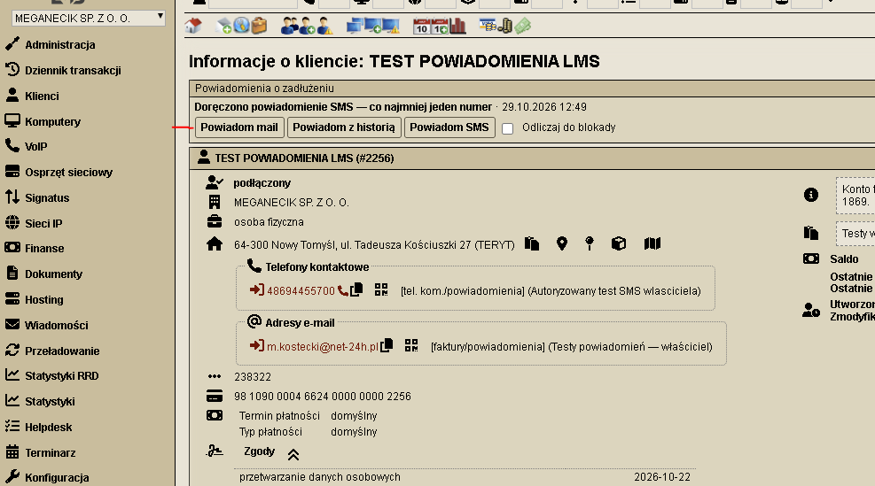

# Płatności i blokady — LMSNotifyPanelPlugin 0.8.4

Wtyczka do LMS+ obsługująca powiadomienia o zadłużeniu, osobne progi blokady internetu i zawieszenia naliczania, powiadomienia o bieżących fakturach oraz historię SMSAPI. Korzysta z mechanizmu wtyczek i metod LMS; nie wymaga edytowania plików źródłowych rdzenia ani wtyczki Huawei.

## Wymagania i zgodność

- LMS+ z obsługą wtyczek, Smarty, Composer i działającą konfiguracją bazy. Instalacja referencyjna: `v27.63-3203-g74d33e49ac`.
- PostgreSQL. Wykorzystywane są między innymi blokady advisory, `DISTINCT ON` i `ON CONFLICT`; wersja dla MySQL/MariaDB nie została przygotowana.
- Część LMS sprawdzona na PHP 8.2. Rozszerzenia: sterownik PostgreSQL używany przez LMS, mbstring, iconv, cURL, JSON i OpenSSL. PHP CLI oraz PHP witryny muszą mieć zgodne rozszerzenia.
- Konto administracyjne LMS z `full_access`, dostęp do instalacji i prawo tworzenia tabel podczas migracji.
- Działający SMTP LMS dla e-maili. SMSAPI wymaga tokenu OAuth z prawem wysyłki, zaakceptowanego nadawcy i środków.
- Automatyka wymaga cron; pobieranie raportów może korzystać z dołączonego timera systemd lub równoważnego harmonogramu.
- Opcjonalny publiczny odbiornik raportów wymaga HTTPS, PHP 7.4+ z PDO SQLite i prywatnego katalogu na kolejkę. Szczegóły: [odbiornik raportów](relay/README.md).

Inne wersje LMS wymagają sprawdzenia schematu bazy i używanych metod. Wtyczka nie gwarantuje zgodności z dowolną instalacją LMS.

**Przed instalacją w innej firmie dostosuj podpisy podmiotów** w `lib/NotifySmsCompany.php` oraz przykłady w `views/sms-preview.php`. Obecne mapowanie identyfikatorów podmiotów jest charakterystyczne dla instalacji referencyjnej.

## Reguły powiadomień i blokad

- Procent zadłużenia to niezapłacony abonament po upływie całego terminu faktury względem miesięcznych opłat cyklicznych brutto po rabatach.
- Domyślne progi: powiadomienie 200%, blokada procentowa 300%, zawieszenie naliczania 400%. Progi są konfigurowalne.
- **Od 0.8.3 próg powiadomienia obowiązuje także wszystkie ręczne SMS-y i e-maile:** pojedyncze, zbiorcze i wiadomości z historią płatności. Porównanie wykonywane jest w groszach; zaokrąglony procent wyświetlany w tabeli nie pozwala ominąć progu.
- Opłaty jednorazowe nie powiększają abonamentowej podstawy progów. Wpłaty przypisane do dokumentu rozliczane są na ten dokument, pozostałe FIFO. Nie przepisuje to księgowań w LMS.
- Przy odliczaniu 0 dni obowiązuje procentowy próg blokady. Przy ustawieniu 7–365 dni zastosowanie mają istniejące reguły skutecznego ostrzeżenia i upływu pełnych dób.
- Wspólny checkbox „Odliczaj do blokady” jest domyślnie odznaczony. Jawnie wybrane ręczne odliczanie może doprowadzić do zlecenia blokady po terminie także przy wyłączonym `auto_block`; nie jest to tylko opis wiadomości.
- Kolejka SMSAPI i status SENT nie uruchamiają odliczania. Od wersji 0.8.4 wystarczy raport DELIVERED na co najmniej jeden numer danej wysyłki, aktualny dług i ten sam cykl zadłużenia. Błąd lub oczekiwanie na drugim numerze nie unieważnia potwierdzonego doręczenia na pierwszy. Kolejne doręczenia nie przesuwają początku odliczania.
- Niepełne dane, nierozpoznane obciążenia lub okresy, obca waluta, wyjątki i ochrona LMS mogą wyłączyć działania. Odblokowanie dotyczy urządzeń i zobowiązań objętych rejestrem tej wtyczki.

Ręczne i automatyczne powiadomienia o zadłużeniu to inny mechanizm niż osobne profile faktur bieżących. Próg 200% nie zastępuje terminów i warunków tych profili faktur.

## Funkcje panelu

- „Finanse → Płatności i blokady”: pełna lista klientów, sortowanie przed paginacją, notatki, wyjątki i historia.
- Oddzielne liczniki klientów ponad progiem blokady i klientów spełniających obecnie wszystkie warunki blokady. Sama liczba ponad progiem nie jest zleceniem odcięcia usług.
- Ręczne e-maile, osobna historia płatności w załączniku HTML, pojedyncze SMS-y i zbiorcze SMS-y do klientów bez e-maila. Każda wysyłka wymaga podglądu oraz osobnego, jednorazowego zatwierdzenia.
- Informacja „Doręczono powiadomienie SMS — co najmniej jeden numer” jest widoczna na liście i w karcie klienta niezależnie od odliczania oraz automatycznych blokad. Osobno pokazano oczekiwanie na raport lub brak doręczenia. Ręczna wysyłka bez zaznaczonego odliczania nie uruchamia licznika.
- W karcie klienta: „Powiadom mail”, „Powiadom z historią”, „Powiadom SMS” i jeden wspólny checkbox odliczania. SMS z karty klienta jest dostępny również przy istniejącym e-mailu.
- Zmiana danych, kontaktów, treści, konfiguracji albo wygaśnięcie potwierdzenia wymaga nowego podglądu. Przed wykonaniem pozycja kolejki ponownie przechodzi kwalifikację.
- Statystyki SMS obejmują liczbę klientów, numerów i segmentów oraz wycenę według stawki podanej przez administratora. Bez stawki nie zakładają kosztu.
- „Powiadomienia o fakturach bieżących”: godzina wysyłki, przełączniki, szablony i lista faktur. Te formularze nie znajdują się w ogólnych ustawieniach wtyczki.
- Historia SMS pokazuje nazwę klienta z linkiem do karty, numer odbiorcy, status i identyfikator operatora.

## Powiadomienia w karcie klienta

Panel w karcie klienta udostępnia przyciski **Powiadom mail**, **Powiadom z historią** i **Powiadom SMS** oraz wspólny checkbox **Odliczaj do blokady**. Wysyłka przechodzi przez podgląd i zatwierdzenie.

Komunikat **„Doręczono powiadomienie SMS — co najmniej jeden numer”** informuje operatora o potwierdzonym doręczeniu także wtedy, gdy odliczanie nie zostało zaznaczone lub automatyczna blokada jest wyłączona. Sam komunikat nie uruchamia blokady. Do rozpoczęcia zaznaczonego odliczania wystarczy raport DELIVERED na jeden z numerów klienta.

Poniższy zrzut z konta testowego został przekazany przez autora.



## Pierwsza instalacja

1. Wykonaj kopię bazy LMS, ustawień, harmonogramów i listy aktywnych wtyczek. Sprawdź pozostałe mechanizmy blokad w instalacji.
2. Skopiuj katalog `LMSNotifyPanelPlugin` do katalogu `plugins/` swojej instalacji LMS. Pliki powinny należeć do administratora i być tylko odczytywane przez proces WWW.
3. Z katalogu LMS uruchom kontrolę i instalację schematu:

```bash
php plugins/LMSNotifyPanelPlugin/tests/policy.php
php plugins/LMSNotifyPanelPlugin/bin/run.php --install-schema --config-file=/etc/lms/lms.ini
composer dump-autoload --optimize --no-scripts --no-interaction
```

Polecenie instalacji tworzy własne tabele `lnp_*` i wykonuje dołączone migracje. Nie wysyła wiadomości ani nie blokuje urządzeń. Nie uruchamiaj `--install-schema` ponownie na istniejącej instalacji.

4. Przy włączonym SELinux przywróć etykiety katalogu wtyczki zgodnie z polityką serwera, np. `restorecon -RF /var/www/html/lms/plugins/LMSNotifyPanelPlugin`.
5. Aktywuj wtyczkę w panelu LMS. Otwórz „Płatności i blokady” kontem z `full_access`.
6. Skonfiguruj progi, nadawcę, szablony oraz kanały. Zweryfikuj podstawę abonamentu, terminy i saldo kilku znanych klientów. Zgody i oznaczenia aktywnych kontaktów są respektowane; instalacja nie zaznacza ich automatycznie.
7. Sprawdź podglądy i oficjalny test połączenia SMSAPI bez wysyłki. Faktyczny test wykonaj dopiero na uzgodnionym numerze/adresie.
8. Zainstaluj potrzebne harmonogramy, a automatykę uruchom dopiero po potwierdzeniu reguł. Automatyczne SMS-y mają osobne zezwolenie, niezależne od ręcznych.

Dostosuj ścieżkę instalacji, konfigurację PHP i użytkownika usług do swojego serwera. Dostęp do panelu nie jest dostępem do CLI ani bazy.

## Aktualizacja

Zachowaj kopię dotychczasowej wtyczki i bazy, podmień jej pliki, a następnie z katalogu LMS wykonaj:

```bash
php plugins/LMSNotifyPanelPlugin/bin/run.php --upgrade-schema --config-file=/etc/lms/lms.ini
composer dump-autoload --optimize --no-scripts --no-interaction
```

Migracja zachowuje ustawienia i dane istniejących tabel. Po aktualizacji do 0.8.3 przygotuj nowe podglądy ręcznych wysyłek. Jeśli istnieją wcześniej zatwierdzone kolejki z wersji ignorującej próg ręczny, zatrzymaj je przed podmianą; w 0.8.3 każda ich pozycja i tak podlega ponownej kontroli progu.

## Harmonogramy

- `bin/run.php` bez `--apply` pokazuje plan. Z `--apply` wykonuje wyłącznie działania włączone w konfiguracji oraz jawne ręczne zlecenia odliczania zgodnie z istniejącymi regułami.
- `cron-reminder.example` zastępuje wcześniejszy wpis przypomnienia o fakturze; nie instaluj drugiej kopii.
- `cron-invoices.example` zawiera profile bieżących faktur po terminie. Przełączniki i wspólną godzinę ustaw w zakładce faktur.
- Ręczne kolejki są przetwarzane z panelu w małych partiach, bez osobnego crona. Niepewne wyniki nie są automatycznie ponawiane.
- `sms-reports.service` i `sms-reports.timer` pobierają raporty co około minutę. Wymagają oddzielnej konfiguracji odbiornika. Sam timer raportów nie wykonuje blokad ani wysyłek.

## SMSAPI i raporty

Token i nadawcę ustaw w panelu. Token nie wraca do formularza i nie jest zapisywany w historii operacji. Puste pole zachowuje token; osobna opcja go usuwa. Token jest przechowywany w bazie, więc kopie bazy muszą być chronione jak inne dane dostępowe.

Test połączenia używa parametru `test=1` i nie wysyła SMS-a. Wysyłka ma limit jednej części, kontrolę numerów oraz trwały zapis próby i stabilny IDX. Czas oczekiwania na API albo błąd transportu oznacza niepewny wynik i wymaga sprawdzenia, nie automatycznej ponownej wysyłki.

Adres raportów HTTPS można podać w ustawieniach wtyczki; jest przekazywany do SMSAPI jako `notify_url` dla każdej nowej wiadomości i ma pierwszeństwo przed globalnym adresem konta. Nie zmienia to konfiguracji wcześniej wysłanych SMS-ów.

Zalecany wariant dla prywatnego LMS to [oddzielny odbiornik i uwierzytelnione pobieranie](relay/README.md). Alternatywny `public/smsapi-status.php` wymaga bezpośredniej, poprawnie zabezpieczonej publicznej trasy do serwera LMS i konfiguracji właściwego pliku `lms.ini`. Nie udostępniaj całego panelu tylko w celu odbierania raportów.

## Weryfikacja i ograniczenia

W instalacji referencyjnej sprawdzono składnię, granice progów, podglądy, kolejki, raporty i odliczanie. Testy integracyjne korzystają z tabel TEMP i atrap wysyłki; przed uruchomieniem na innej instalacji należy przeczytać dany test i zweryfikować jego izolację. Test odbiornika `tests/sms-relay.php` wymaga PDO SQLite i używa tymczasowej bazy bez połączeń zewnętrznych.

Potwierdzono także rzeczywiste doręczenie SMS oraz rzeczywisty raport, który uruchomił licznik przy symulowanym długu w tabelach TEMP. Nie jest to gwarancja doręczenia wszystkich przyszłych wiadomości.

Sama zmiana `nodes.access` wymaga działającego w danej sieci mechanizmu wdrażania konfiguracji, aby odciąć usługę. LMS przechowuje pojedynczy stan dostępu urządzenia, więc nie potrafi zawsze rozróżnić blokad nakładanych przez niezależne systemy. Automatyczne odblokowanie należy stosować dopiero po analizie tych mechanizmów.

## Wycofanie

Wyłącz automatykę i harmonogram raportów, przywróć poprzednie pliki oraz konfigurację odbiornika. Zachowaj bazę i rejestry. Usunięcie wtyczki nie odblokowuje urządzeń, nie wznawia zawieszonych zobowiązań i nie cofa wysłanych wiadomości. Takie zmiany wymagają osobnej, świadomej operacji.
